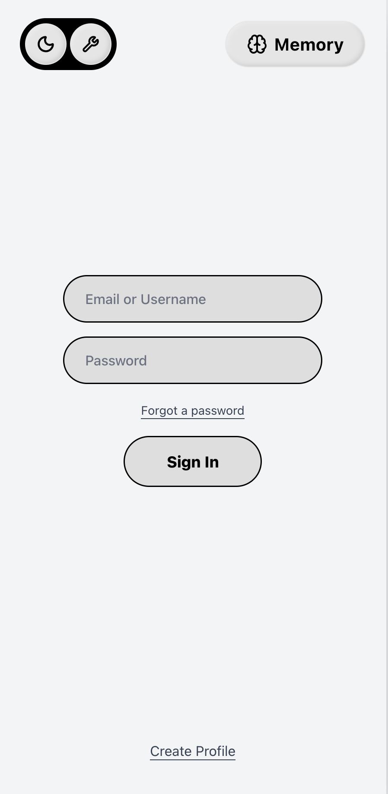
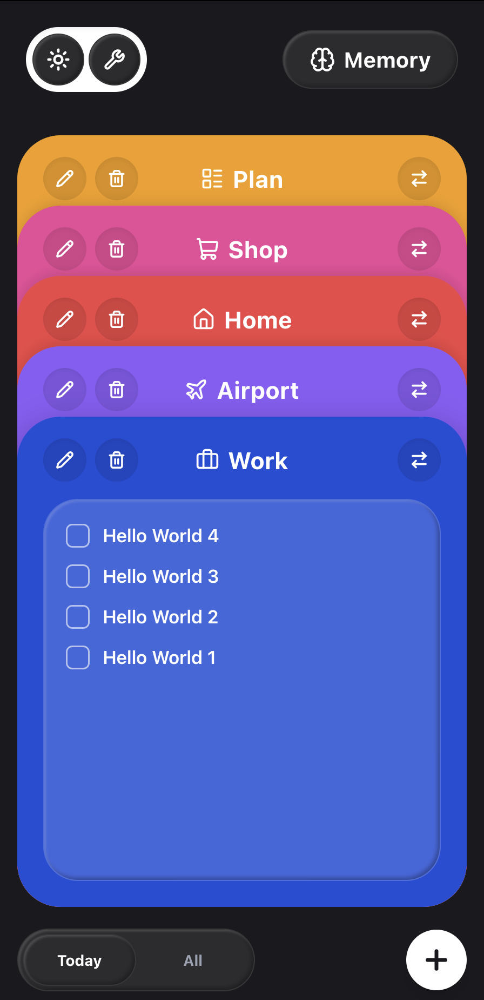
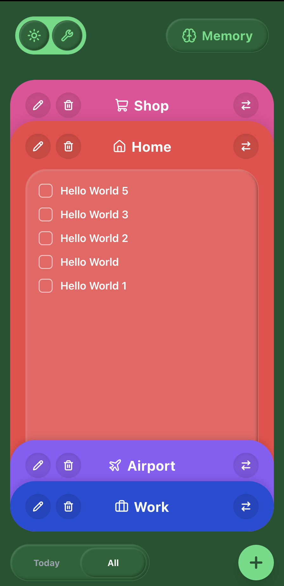
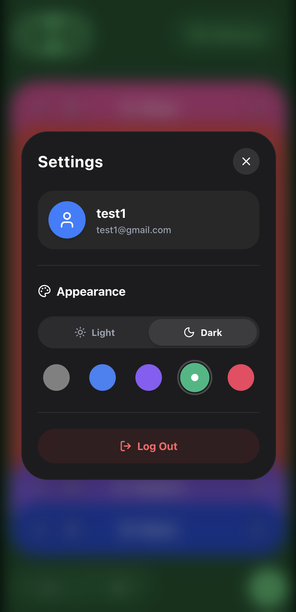

# 🧠 Memory App – Full-Stack Task & Memory Organizer


A modern, responsive full-stack web application for organizing daily tasks, managing custom lists, and securely storing personal memories.

Built with TypeScript, React, Node.js, and PostgreSQL, the application focuses on scalability, security, and a seamless user experience.

---

## 🚀 Live Demo

- **Frontend:** [Memory App – Live Demo](https://memory-client-azure.vercel.app)
- **Backend API:** [Memory API](https://memory-server-qxcj.onrender.com)

---

## 📸 Screenshots

### 🔐 Authentication

<p align="center">
  
</p>

### 📊 Main Dashboard

<p align="center">
  
</p>

### 📋 Custom Lists

<p align="center">
  
</p>

### ⚙️ Settings & Profile

<p align="center">
  
</p>

Screenshots of the application will be added here.

|         Login / Authentication          |             Main Dashboard              |          Settings & Profile           |
| :-------------------------------------: | :-------------------------------------: | :-----------------------------------: |
|  |  |  |

> Replace the image paths above with your actual screenshots. You can create a `screenshots` folder in the root directory of the repository.

---

## 💻 Tech Stack

### Frontend (`/memory-client`)

- **Framework:** React / Next.js
- **Language:** TypeScript
- **State Management:** Zustand
- **Styling:** Tailwind CSS
- **HTTP Client:** Axios
- **Deployment:** Vercel

### Backend (`/memory-server`)

- **Runtime:** Node.js
- **Framework:** Express.js
- **Language:** TypeScript
- **Validation:** Zod
- **Database Connector:** `pg` (PostgreSQL connection pool)
- **Authentication:** JSON Web Tokens (JWT)
- **Password Hashing:** bcrypt
- **Security:** CORS
- **Deployment:** Render

### Database

- **Provider:** Neon Serverless PostgreSQL
- **Connection:** SSL-enabled PostgreSQL connections
- **Migrations:** Custom SQL migration scripts using `tsx`

---

## ✨ Features

### 🔐 Secure Authentication

- User registration and login.
- JWT-based authentication.
- Secure password hashing with bcrypt.
- Protected API endpoints.

### 👤 Personalized User Data

- Each user has access only to their own tasks and lists.
- User-specific data management through relational `userId` associations.
- Secure database queries.

### 📋 Task Management

- Create, update, and delete tasks.
- Manage task completion status.
- Organize tasks into custom lists.
- View tasks using different filtering options.

### 📅 Dynamic Views

- **Today:** View tasks scheduled for the current day.
- **All:** View all available tasks.

### 🛡️ Data Validation & Security

- Request validation using Zod.
- JWT-based route protection.
- Password hashing.
- CORS configuration to control frontend access to the backend API.

### ☁️ Cloud Deployment

- Frontend hosted on Vercel.
- Backend hosted on Render.
- PostgreSQL database hosted on Neon.

---

## 🏗️ Project Structure

```text
Memory-App/
│
├── memory-client/          # Frontend application
│
├── memory-server/          # Backend application
│   ├── src/
│   ├── package.json
│   └── ...
│
└── README.md
```

---

## 🛠️ Getting Started

Follow these instructions to run the project locally.

### Prerequisites

Make sure you have installed:

- [Node.js](https://nodejs.org/) (v18 or later)
- [Git](https://git-scm.com/)
- [PostgreSQL](https://www.postgresql.org/) or a [Neon](https://neon.tech/) account
- npm

### 1. Clone the Repository

```bash
git clone https://github.com/ArtemSapotnitskyi/Memory-App.git

cd Memory-App
```

### 2. Configure Environment Variables

Create a `.env` file in both the frontend and backend directories.

**Backend: `memory-server/.env`**

```env
PORT=5004
DATABASE_URL=postgresql://<username>:<password>@<hostname>/<database>?sslmode=require
JWT_SECRET=your_secure_secret_key
```

**Frontend: `memory-client/.env`**

```env
NEXT_PUBLIC_API_URL=http://localhost:5004/api
```

> Important: Never commit `.env` files or expose your database credentials or JWT secret. Make sure they are included in `.gitignore`.

### 3. Install and Run the Backend

Open a terminal:

```bash
cd memory-server

npm install

# Run database migrations
npm run migrate

# Start the development server
npm run dev
```

The backend API should now be available at:

`http://localhost:5004`

### 4. Install and Run the Frontend

Open a second terminal:

```bash
cd memory-client

npm install

# Start the development server
npm run dev
```

The frontend should now be available at:

`http://localhost:3000`

---

## 📡 API Documentation

The backend exposes REST API endpoints for authentication, task management, and custom lists.

All protected routes require a valid JWT authentication token.

### 🔐 Authentication

| Method | Endpoint             | Description                           |
| :----: | -------------------- | ------------------------------------- |
|  POST  | `/api/auth/register` | Register a new user                   |
|  POST  | `/api/auth/login`    | Authenticate a user and receive a JWT |

### 📋 Lists

| Method | Endpoint         | Description                                            |
| :----: | ---------------- | ------------------------------------------------------ |
|  GET   | `/api/lists`     | Retrieve all lists belonging to the authenticated user |
|  POST  | `/api/lists`     | Create a new list                                      |
| DELETE | `/api/lists/:id` | Delete a specific list                                 |

### ✅ Items / Tasks

| Method | Endpoint         | Description                              |
| :----: | ---------------- | ---------------------------------------- |
|  GET   | `/api/items`     | Retrieve the authenticated user's items  |
|  POST  | `/api/items`     | Create a new task or item                |
|  PUT   | `/api/items/:id` | Update task details or completion status |
| DELETE | `/api/items/:id` | Delete a specific task or item           |

**Task filtering:**

The `/api/items` endpoint supports filtering through the `viewType` query parameter:

- `Today` – Returns items for the current day.
- `All` – Returns all items belonging to the authenticated user.

Example:

```http
GET /api/items?viewType=Today
```

---

## 🔒 Security

Security is an important part of this application.

The project includes:

- JWT-based authentication.
- Password hashing using bcrypt.
- Protected API routes.
- User-specific database queries.
- Request validation with Zod.
- SSL-enabled PostgreSQL connections.
- CORS configuration.

---

## 🚀 Deployment

The application is deployed using the following services:

| Service  | Platform                      |
| -------- | ----------------------------- |
| Frontend | [Vercel](https://vercel.com/) |
| Backend  | [Render](https://render.com/) |
| Database | [Neon](https://neon.tech/)    |

---

## 👨‍💻 Author

**Artem Sapotnitskyi**

- GitHub: [@ArtemSapotnitskyi](https://github.com/ArtemSapotnitskyi)
- Repository: [Memory App](https://github.com/ArtemSapotnitskyi/Memory-App)

---

## ⭐ Support

If you find this project useful or interesting, consider giving it a ⭐ on GitHub!

Your support is greatly appreciated.

---

**Built with ❤️ using React, TypeScript, Node.js, and PostgreSQL.**
